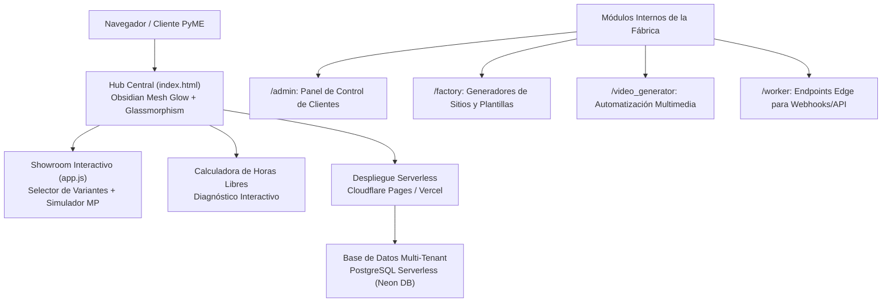

# Arquitectura del Sistema — CaribIA Labs

## Visión General
CaribIA Labs combina un frontend ultra-liviano de alta conversión con servicios serverless:

## Estructura de Directorios
- `index.html`, `styles.css`, `app.js`: Hub corporativo principal de la Software Factory.
- `database/schema.sql`: Esquema PostgreSQL multi-tenant (Neon DB) con soporte para tenants, productos, órdenes y transacciones.
- `admin/`: Interfaz para administración de clientes y pedidos.
- `factory/`: Scaffolding y templates de landing pages para clientes.
- `video_generator/`: Automatización con Puppeteer Core para generación de creatividades y videos de marketing.
- `instagram/`: Templates y creatividades para captación en redes sociales.
- `assets/`: Recursos visuales de marcas reales incubadas.
